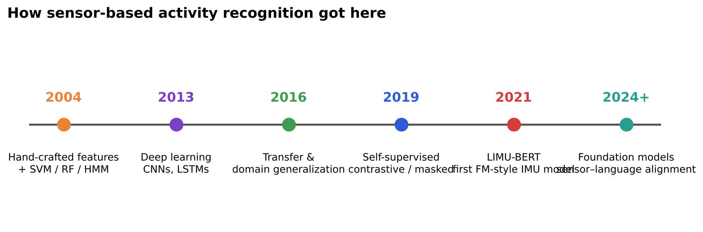
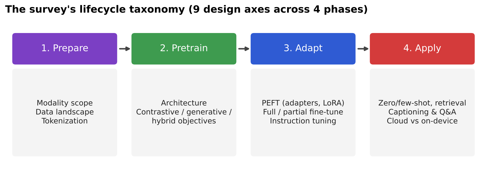
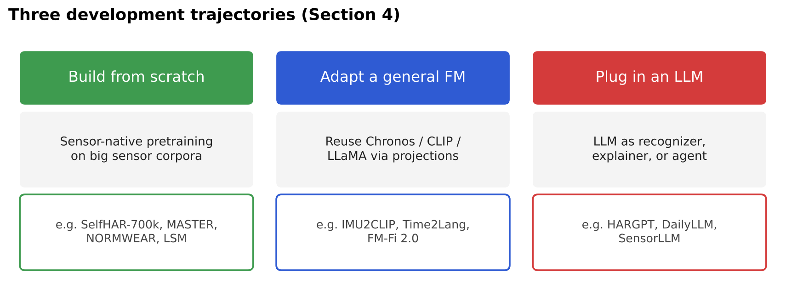

# Foundation Models for Sensor-based Human Activity Recognition — Paper Review

CMPE 255 (Data Mining) individual assignment: a short, visual review of a 2026 survey paper.

## The paper

**Foundation Models Defining a New Era in Sensor-based Human Activity Recognition: A Survey and Outlook**
Sizhen Bian, Mengxi Liu, Lala Shakti Swarup Ray, Bo Zhou, Bin Guo, Zhiwen Yu, Thomas Plötz, Paul Lukowicz, Siyu Yuan, Vitor Fortes Rey
*Proc. ACM on Interactive, Mobile, Wearable and Ubiquitous Technologies (IMWUT / UbiComp)*, Vol. 10, No. 2, Article 31, June 2026
DOI: [10.1145/3810230](https://doi.org/10.1145/3810230) · License: CC BY 4.0

## Why it fits CMPE 255

- **Self-supervised representation learning** on large unlabeled datasets (contrastive and masked objectives)
- **Time-series mining**: windowing, feature aggregation, spectrograms, discrete tokenization of sensor streams
- **Generalization & evaluation**: cross-dataset/user/device protocols, open-set metrics, Recall@K
- **Exhaustive and current**: 132 papers, most from 2024–2025, in a flagship ubiquitous-computing venue

## What's in this repo

| File | Description |
|---|---|
| `Foundation Models for Sensor HAR.pdf` | Short presentation deck |
| `figures/` | Six original diagrams used in the article and slides |

## Key takeaways

1. HAR is moving from small, task-specific classifiers to **pretrain-once, reuse-everywhere** foundation models.
2. The survey organizes the field into a **4-phase lifecycle** (prepare → pretrain → adapt → apply) with nine design axes.
3. Three trajectories: **build sensor-native models**, **adapt general time-series/vision–language models**, and **plug in LLMs** for reasoning.
4. Evaluation must go beyond IID accuracy: cross-domain, open-set, retrieval, and on-device cost metrics.

## Figures

## Credits

All research content belongs to the original authors. Figures in this repo are my own summaries. Paper index maintained by the authors: [zhaxidele/Foundation-Models-Defining-A-New-Era-In-Human-Activity-Recognition](https://github.com/zhaxidele/Foundation-Models-Defining-A-New-Era-In-Human-Activity-Recognition).
